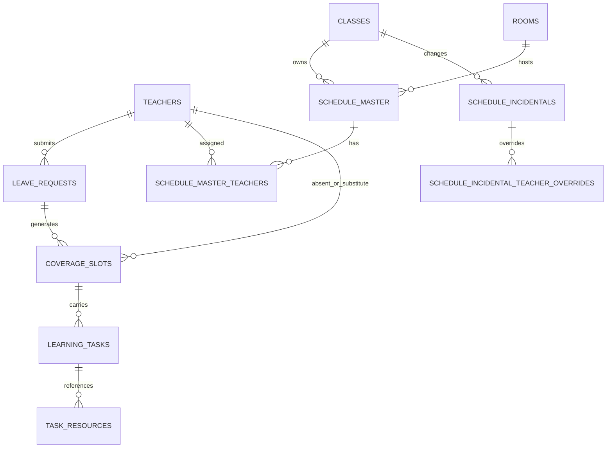

# E-Jadwal V3 Persistence Architecture

```text
Browser / React on Vercel
          |
          +---- Supabase Auth
          |
          +---- Repository Layer ---- PostgreSQL (structured data)
          |                              |
          |                              +-- schedules
          |                              +-- academic calendar
          |                              +-- leave requests
          |                              +-- coverage / badal queue
          |                              +-- task metadata
          |                              +-- audit log
          |
          +---- Drive Upload Gateway ---- Google Drive (actual files)
                    Apps Script / Google API
```

## Source of truth

After the migration cutover, PostgreSQL is the source of truth for operational structured data. Google Drive is the source of truth for uploaded file bytes. Google Sheets is not a transactional source of truth after cutover.

During migration, the duplicated staging Sheet remains the comparison source until parity is proven.

## Domain boundary

`src/domain/schedule/effectiveSchedule.ts` stays independent from persistence. Repository adapters are responsible for converting storage rows into domain objects.

This boundary is the central migration safety mechanism.

## Core relational shape



The diagram intentionally omits authentication/audit edges to keep the operational model readable.
